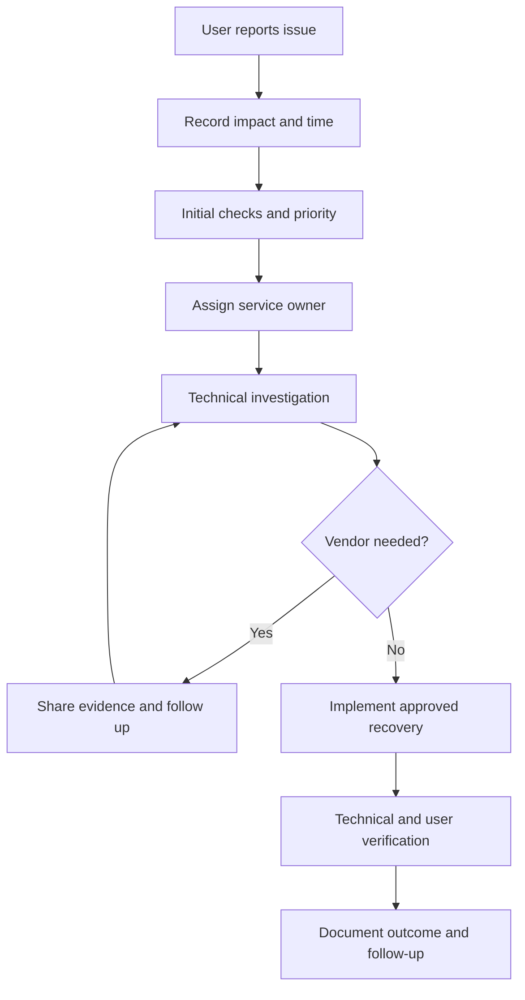

# Documentation Guide - Enterprise IT Operations

Use this structure for monitoring, telephony, CCTV/NVR, fiber, ERP, endpoint support, vendor management and IT operations pages.

## Evidence labels

- **Production experience:** Work I have been involved in, described without confidential details.
- **Sanitized reference:** A reduced or anonymized procedure/configuration.
- **Lab/demo:** An independently authored example for learning or demonstrating a workflow.
- **Template:** A reusable form or checklist, not a completed company record.
- **Planning reference:** An estimate or design method whose assumptions must be stated.

Never present a sample workflow, fictional ticket or lab as an actual production result.

## Page structure

1. **Purpose and business impact** - Which service or user need does this support?
2. **Scope and evidence** - Production experience, sanitized reference, lab/demo or template.
3. **Architecture/workflow** - Mermaid diagram showing users, systems, network, vendor or service dependencies.
4. **Prerequisites** - Access, approvals, licensing, support contract, maintenance window and dependencies.
5. **Configuration/procedure** - Ordered steps with safe placeholders.
6. **Troubleshooting** - Symptoms, evidence, possible causes, escalation and safe next step.
7. **Verification and acceptance** - Technical check plus user/service-owner confirmation.
8. **Rollback/recovery** - Recovery action, owner and trigger.
9. **Operations ownership** - Who monitors, responds, communicates and reviews the service.
10. **What I learned** - A practical lesson, limitation or improvement to test.
11. **References** - Vendor documentation and related pages.

## Example service workflow

## Example incident record

| Field | Record |
|---|---|
| Service/asset | Use an approved internal identifier; do not expose it publicly |
| Impact | Users, location, service and business effect |
| Timeline | Detection, acknowledgement, action, recovery |
| Evidence | Redacted logs, monitoring and test results |
| Owner | Role or team, not personal contact details |
| Recovery | Action taken and validation |
| Follow-up | Action, owner and due date |

## Management and people practices

Describe how work is prioritized, delegated, handed over and reviewed. Do not invent team sizes, budgets, savings, MTTR, uptime or SLA achievements. Use clearly marked sample data when demonstrating a template. Explain where an example should be adapted to an organization's policies and actual authority structure.

## Security and privacy

Do not publish customer data, personal attendance records, camera addresses, internal phone numbers, credentials, contracts, vendor ticket IDs, private diagrams or employer documents. Use fictional sample values and state when a diagram is illustrative.
