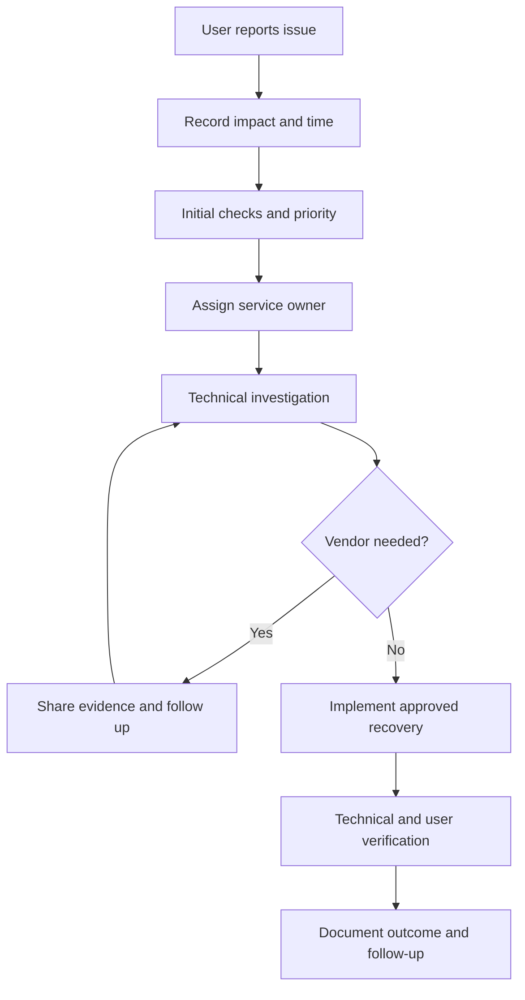

# How I document IT operations

These notes are for services such as monitoring, telephony, CCTV/NVR, fiber, ERP, endpoint support and vendor coordination. I want the reader to understand what the service does, what can go wrong and who needs to be involved when it does.

## Be clear about the source

- **Production experience:** Work I have been involved in, described without confidential details.
- **Sanitized reference:** A procedure or configuration with identifying information removed.
- **Lab/demo:** A separate example used to learn or demonstrate a process.
- **Template:** A form or checklist that still needs to be adapted.
- **Planning reference:** An estimate or design approach with its assumptions stated.

A sample ticket is not a real incident. A checklist does not prove that a project was completed. Keep those distinctions clear.

## What I try to cover

Not every page needs every item below. Include what a person needs to understand or carry out the work.

1. Which service or user need is involved?
2. Who or what depends on it?
3. What access, approval, license, contract or maintenance window is needed?
4. What are the steps, in the order they should happen?
5. What does a fault look like, and what evidence should be collected?
6. When should another team or vendor be involved?
7. How will the technical result be checked?
8. Who can confirm that the service is working for users?
9. What is the rollback or recovery option?
10. Which vendor documents or related notes should the reader consult?

## Example service workflow

## Example incident record

| Field | What to record |
|---|---|
| Service/asset | Use an approved internal reference; do not expose it publicly |
| Impact | Affected users, location, service and business effect |
| Timeline | When it was noticed, acknowledged, worked on and restored |
| Evidence | Redacted logs, monitoring and test results |
| Owner | Responsible role or team |
| Recovery | What was done and how it was checked |
| Follow-up | Next action, owner and due date |

## When writing about management work

Explain how a task was prioritized, who needed to be involved, how the handover worked and what happened afterward. Do not invent team sizes, budgets, savings, MTTR, uptime or SLA results. If you use sample data to show a form, label it as an example.

Keep customer data, personal attendance records, camera addresses, internal phone numbers, credentials, contracts, vendor ticket IDs, private diagrams and employer documents out of public pages. Use fictional values where an example needs them.

---

**A note on this documentation:** The technical work and experience behind these notes are mine. Some wording and the way I have organized the material have had AI assistance, mainly to make the writing clearer and save time. The examples, decisions and work described are not AI-generated. I check what I publish and stand behind it.
