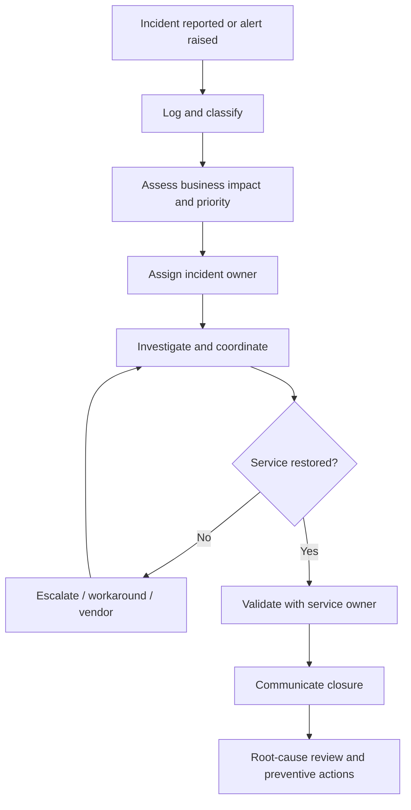

# IT Leadership & Operations Playbook

This playbook documents the operating habits that help technical work become dependable service delivery. It is written as a practical reference for an IT infrastructure team, not as a claim about a specific reporting line, team size, budget, or KPI.

## 1. Leadership in day-to-day IT operations

Good technical leadership is not only assigning tickets. It means making priorities clear, removing blockers, keeping communication calm, and ensuring that work is completed safely.

A practical team lead should:
- Explain the business impact and expected outcome, not just pass on a task.
- Match work to capability while giving people room to learn.
- Make ownership and escalation paths visible.
- Review progress without micromanaging every command.
- Give credit to the people who did the work.
- Share context and documentation so knowledge does not remain with one person.
- Escalate risks early rather than hiding delays.

**Human principle:** When an incident is active, focus first on restoring service and protecting users. Review individual decisions fairly after the facts are clear. Blame makes people hide information; a learning review makes the next response better.

## 2. Incident management workflow

### Severity should follow impact

| Priority | Example impact | Response focus |
|---|---|---|
| Critical | Multiple sites or a business-critical service unavailable | Immediate coordination, frequent updates, escalation |
| High | Important department or core function materially degraded | Prioritized investigation and clear owner |
| Medium | Limited group affected; workaround exists | Planned restoration and user communication |
| Low | Individual request or non-urgent improvement | Queue, schedule, and track |

Adapt severity definitions and response targets to the organization's approved SLA and business hours.

### Incident roles

- **Incident owner:** Maintains the timeline, priority, actions, and next update.
- **Technical investigator:** Runs diagnostics and reports evidence.
- **Service/business contact:** Confirms business impact and validates recovery.
- **Vendor/provider contact:** Coordinates external fault investigation and escalation.
- **Communicator:** Keeps affected stakeholders informed; this can be the incident owner in a small team.

One person may cover multiple roles in a small team. The important thing is that ownership is explicit.

## 3. People management and task coordination

A lightweight daily coordination board can prevent urgent work from being lost.

| Work item | Owner | Priority | Dependency | Due / next update | Status |
|---|---|---|---|---|---|
| Example: WAN fault follow-up | Network engineer | High | Provider NOC | 11:30 update | In progress |
| Example: backup restore test | Systems engineer | Medium | Test storage | Planned window | Scheduled |
| Example: access request | Service desk | Low | Manager approval | Next review | Waiting |

These are sample entries, not records of actual incidents or employees.

Useful habits:
- Start with a short review of incidents, changes, planned work, and blockers.
- Give each task one accountable owner and a clear completion condition.
- Pair less experienced colleagues with a reviewer for risky changes.
- Rotate routine work fairly and document handovers.
- Hold short knowledge-sharing sessions after meaningful troubleshooting.
- Discuss workload privately and respectfully when priorities conflict.

## 4. Time management and prioritization

Use impact, urgency, risk, and dependency to decide what should happen next.

**Example day structure (adapt to shift and incident load):**
- Start of shift: review alerts, open incidents, handover, and maintenance windows.
- Protected focus block: planned engineering or documentation work.
- Mid-shift: vendor follow-up, user updates, approvals, and dependency checks.
- End of shift: verify open work, update tickets, hand over risks, and record next actions.

Do not treat this as a rigid timetable. A critical incident takes priority over the planned focus block; the displaced work should be rescheduled rather than silently forgotten.

### A simple prioritization test

1. Is a business-critical service down?
2. Is there a security, safety, or data-loss risk?
3. Is another team or change window blocked by this task?
4. Is there an agreed SLA or deadline?
5. Can the work be safely scheduled later?

## 5. Documentation that people can actually use

A useful document should help the next engineer act safely under pressure.

Every operational runbook should include:
- Purpose and scope
- Service owner and escalation contact (kept private where appropriate)
- Prerequisites and access requirements
- Known dependencies
- Step-by-step checks
- Expected result and failure indicators
- Recovery and rollback steps
- Validation from the user/service perspective
- Last reviewed date and document owner

### Example change record

| Section | Example |
|---|---|
| Objective | Update a network or server component |
| Scope | Named service/device in the approved internal record |
| Risk | Service interruption or compatibility issue |
| Pre-check | Backup, health, capacity, dependencies |
| Window | Approved maintenance window |
| Implementation | Ordered, peer-reviewed steps |
| Rollback | Trigger, owner, and tested recovery path |
| Validation | Monitoring plus service-owner confirmation |
| Closure | Actual outcome, evidence, and follow-up |

Never store passwords, private keys, recovery codes, or sensitive production topology in public documentation.

## 6. Vendor and SLA management

A productive vendor escalation is specific and evidence-based.

Include:
- Service/circuit reference through an approved private channel
- Impacted locations and services
- First observed time and current status
- Tests already completed and their results
- Screenshots/log excerpts with sensitive data removed
- Business impact and required next update
- Named owner for the next action

Track commitments, warranty/support expiry, recurring faults, response quality, and unresolved risks. Do not close an incident merely because a vendor says the circuit is clear; validate the service from the customer side.

## 7. Implementation example — introducing a monitoring workflow

This is a reusable implementation example, not a claim that a particular rollout or measured improvement occurred.

1. Inventory critical devices and services.
2. Agree monitoring ownership, access, and SNMP/security standards.
3. Onboard a small pilot group.
4. Define meaningful availability, resource, interface, and service checks.
5. Tune thresholds to reduce noisy alerts.
6. Test notification routing and escalation.
7. Document dashboards, alert meaning, first checks, and ownership.
8. Review false positives and missed alerts with the team.
9. Expand in phases after the pilot is stable.

**Acceptance checks:** A test alert is received by the right person, the runbook identifies first checks, an escalation path exists, and the service owner understands the alert's business meaning.

## 8. Post-incident review

Keep the review blameless and evidence-based.

- What happened and who/what was affected?
- What did monitoring detect, and what did it miss?
- Which actions helped restore service?
- Where did communication or handover slow down?
- What was the confirmed root cause?
- Which preventive actions have an owner and due date?

Separate confirmed facts from assumptions. A follow-up without an owner and due date is only a suggestion, not an action plan.

## 9. A realistic operational mindset

I value stable service, honest status updates, careful changes, and documentation that another engineer can follow. Technical knowledge matters, but so do patience, listening, coordination, and respect for the people who depend on IT services.

The examples in this playbook are templates to adapt to the organization's actual authority, team structure, policies, and service commitments.
