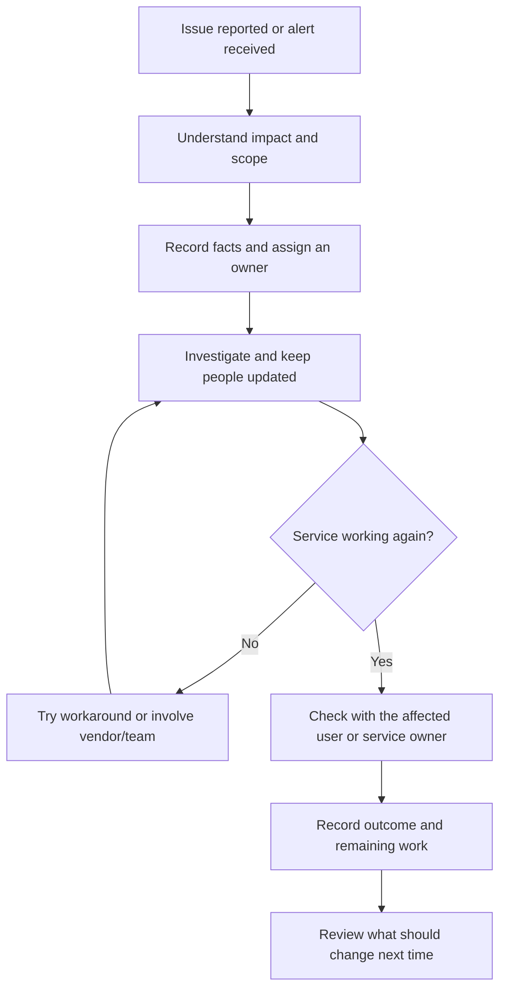

# IT Leadership & Operations Notes

I have learned that keeping IT services running takes more than knowing the right command. Someone has to understand the impact, decide what needs attention first, keep people informed and make sure the work is handed over properly.

I have worked alongside technical teams, users and vendors on infrastructure and service issues. I am also working to grow further into IT leadership. These notes collect the habits I try to follow and a few templates that can be adapted to a team's actual process. They are not a record of a particular team structure, budget or KPI result.

## When something breaks

My first questions are usually simple: what stopped working, who is affected, when did it start and is there a safe workaround? I want to know the business impact before deciding how urgent the technical fix is.

A basic incident flow looks like this:

### Setting priority

The labels below are examples. Every organization should set its own response targets and severity rules.

| Priority | Example | What I would focus on |
|---|---|---|
| Critical | A core service or several sites are down | Get the right people involved, restore service and send regular updates |
| High | A key department or important function is badly affected | Give it a clear owner and keep the investigation moving |
| Medium | A smaller group is affected and has a workaround | Agree a restoration plan and keep users informed |
| Low | An individual request or non-urgent improvement | Schedule it and make sure it does not disappear from the queue |

In a small team, one person may handle several roles. I still want the responsibilities to be clear: who is coordinating, who is investigating, who can confirm business impact and who is speaking with the vendor.

## Working with people

I do not think coordination means watching every command someone runs. It means making sure the person doing the work understands why it matters, what the expected result is and when to ask for help.

For a shared task list, I would keep the information simple:

| Work item | Owner | Priority | Dependency | Next update | Status |
|---|---|---|---|---|---|
| Example: WAN fault follow-up | Assigned engineer | High | Provider NOC | 11:30 | In progress |
| Example: backup restore test | Assigned engineer | Medium | Test storage | Planned window | Scheduled |
| Example: access request | Service desk | Low | Approval | Next review | Waiting |

These are sample entries, not actual employee or incident records.

A few things I try to do:
- Give a task one clear owner and explain what “done” should look like.
- Check workload before assigning more work to someone who is already handling an incident.
- Pair a colleague with a reviewer when a change has a high risk.
- Share what I know, and ask when I do not know something.
- Give credit to the people who did the work.
- Discuss mistakes using facts. Hiding a problem or blaming someone does not help the next person fix it.

## Managing time when everything feels urgent

I start by looking at open incidents, alerts, planned changes and handover notes. If a critical issue comes in, the plan for the day may have to change. I try to make sure the work that gets displaced is recorded and rescheduled instead of being forgotten.

When several requests compete for attention, I consider:
1. Is a business-critical service unavailable?
2. Is there a security, safety or data-loss risk?
3. Is another team waiting on this task?
4. Is there an agreed SLA or deadline?
5. Can it wait without creating a bigger problem?

A simple handover at the end of a shift should say what happened, what has been checked, what is still open, who owns the next step and when someone should follow up.

## Notes that help the next engineer

I have seen how much time gets wasted when the next person has to repeat checks because nobody wrote down what had already been tried. A useful runbook or ticket should give the next engineer enough context to continue.

For a change or troubleshooting note, I would record:
- What service or device is involved
- What prompted the work and who is affected
- What was checked before making a change
- What was changed, in the order it happened
- What result was expected and what actually happened
- How the service was checked afterward
- Whether rollback was needed or remains possible
- What still needs attention and who owns it

Do not put passwords, private keys, recovery codes or confidential production details in public documentation.

## Working with vendors

When I contact a vendor or service provider, I try to send useful information rather than just saying that something is not working. That usually means the time the issue started, the affected service, the impact, checks already completed and the result of those checks.

I also keep track of who is handling the next action and when I should follow up. A vendor saying that a circuit or service is clear is not enough on its own; the service should be checked from the user or customer side as well.

Keep circuit references, customer details, screenshots and logs in the organization's approved private channels. Do not put them in this public repository.

## Example: setting up a monitoring process

This is an example of how I would approach a monitoring rollout. It is not a claim that a specific deployment or measured improvement took place.

1. List the devices and services that matter most to the business.
2. Confirm who owns each service and who should receive alerts.
3. Start with a small group of devices.
4. Add checks for availability, resource use, interfaces and important services.
5. Review thresholds so normal activity does not create constant alerts.
6. Test alert delivery and escalation.
7. Write down what the alert means and what the first checks should be.
8. Review missed alerts and false alarms before expanding.

I would consider the pilot useful when an alert reaches the right person, the first checks are documented and the service owner understands what the alert means. The monitoring dashboard alone is not the finish line.

## After an incident

Once the service is stable, I want to understand what happened without turning the review into a search for someone to blame.

- What was affected, and for how long?
- What did we know at the time?
- Which checks or actions helped?
- Did communication or handover cause a delay?
- What do we know about the cause, and what is still an assumption?
- What should be changed, who will do it and by when?

If the cause is not confirmed, I would rather say that than write a confident but unsupported explanation. An action without an owner and a due date is easy to forget.

## What I want to keep improving

I want to become better at planning work, supporting colleagues, handling difficult incidents and communicating with people who are not technical. I will not know every answer, and I do not expect anyone else to. What matters to me is being honest about the situation, taking responsibility for my part and making sure the team learns something useful from the work.

The templates here should be adjusted to the organization's real policies, authority, team size and service commitments.
